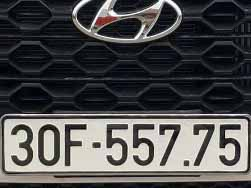
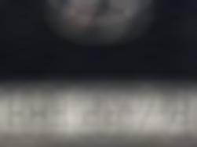
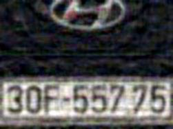
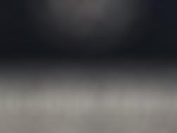
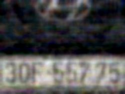
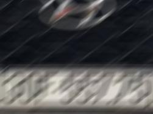
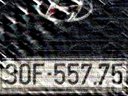
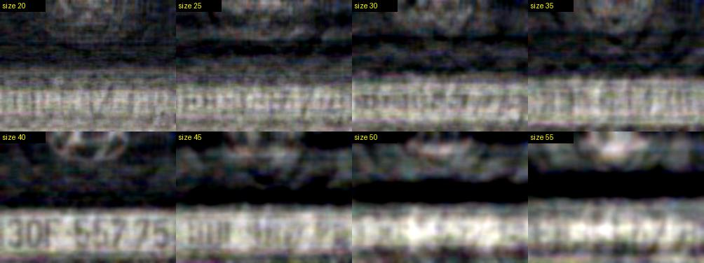
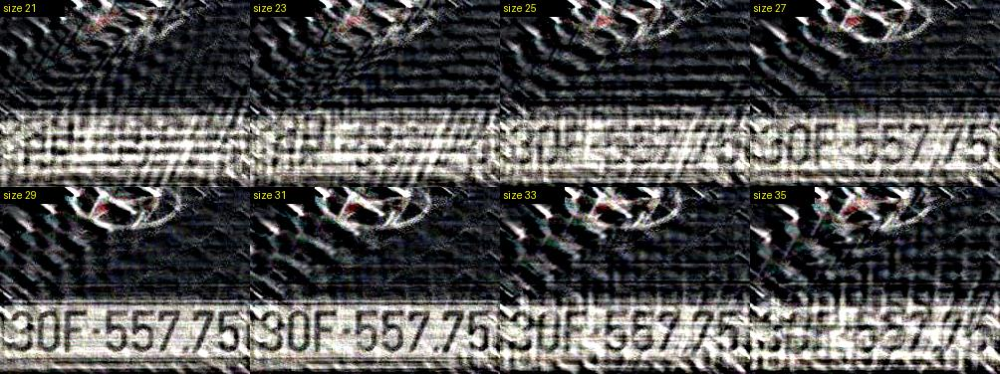
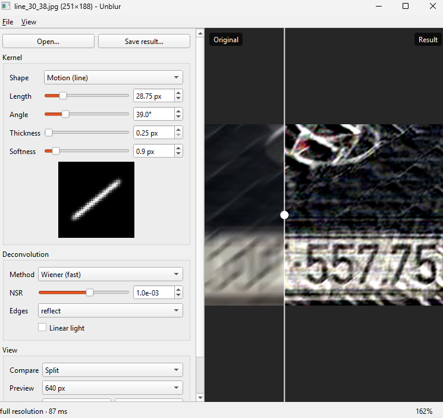

# unblur

Image unblurring by deconvolution (Wiener and Richardson-Lucy), inspired by
<https://maxvanleeuwen.com/project/unblurring-images/>. Desktop app (PySide6),
command line, and Python library.

## Examples

**Original image**



### When the kernel is known

| Setup | Blur Image | Deblur image |
|---|---|---|
|blur --kernel disk --size 20|||
|blur --kernel disk --size 40|||
|blur --kernel line --size 30 --angle 38|||

Example command:
- Blur: `python -m unblur blur images\example4\original.jpg images\example4\line_30_38.jpg --kernel line --size 30 --angle 38`
- Deblur: `python -m unblur deblur images\example4\line_30_38.jpg images\example4\deblur_line_30_38.jpg --kernel line --size 30 --angle 38`

### When the kernel size is unknown

Find the size of the kernel

**Disk blur**


finding disk size


- Deblur sweep: `python -m unblur sweep images\example4\disk_40.jpg images\example4\deblur_disk_sweep_20_55.jpg --kernel disk --sizes 20:55:5`

**Line blur**


finding line size


- Deblur sweep: `python -m unblur sweep images\example4\line_30_38.jpg images\example4\deblur_line_sweep_21_35.jpg --kernel line --sizes 21:35:2 --angle 38`

## The GUI

Command to run the GUI: `python -m unblur gui`



## Setup

```powershell
.venv\Scripts\python.exe -m pip install -r requirements.txt
```

## Desktop app

```powershell
.venv\Scripts\python.exe -m unblur gui
.venv\Scripts\python.exe -m unblur gui images\example4\disk_40.jpg
```

Open an image (`Ctrl+O`, or drop it on the window), then move the sliders. The
result updates as you go, and hovering over a control explains it.

1. Pick the **Shape** that matches the blur, and compare the **kernel picture**
   with a smeared dot in the photo. See
   [Finding the right kernel values](#finding-the-right-kernel-values).
2. Drag **Length/Radius** (and **Angle**) until ghost copies and rings disappear.
3. Adjust **NSR** or **Iterations** to trade sharpness against grain.
4. **Save result…** (`Ctrl+S`) renders at full resolution, whatever the preview size.

| Viewer | |
|---|---|
| Wheel / drag | zoom around the cursor / pan |
| Drag the white line | move the before/after split |
| `Ctrl+1` / `Ctrl+2` / `Ctrl+3` | split / result only / original only |
| `F` / `1` | fit to window / 100% |

**Preview** sets the longest side of the live render. Images larger than that are
shrunk, with the kernel scaled to match, so the preview only approximates the final
result: choose **Full resolution** to check fine detail. Sizes stay in original-image
pixels, so the values you find also work on the command line.

Measured on a 4000×3000 photo (radius 20):

| Preview | Wiener | Richardson-Lucy, 30 iterations |
|---|---|---|
| 640 px | 0.2 s | 2 s |
| 1024 px (default) | 0.5 s | 5 s |
| 1600 px | 1.3 s | 23 s |

Richardson-Lucy shows its progress as it runs, and changing a setting restarts it.

## Command line

```powershell
# Synthetic end-to-end test: blurs a chart with 4 kernels, deblurs, prints PSNR,
# writes output\demo_sheet.png
.venv\Scripts\python.exe -m unblur demo

# Make a blurred test image, then recover it
.venv\Scripts\python.exe -m unblur blur   output\demo_sharp.png output\b.png --kernel line --size 21 --angle 30 --noise 0.002
.venv\Scripts\python.exe -m unblur deblur output\b.png output\d.png --kernel line --size 21 --angle 30 --nsr 3e-3 --reference output\demo_sharp.png

# Don't know the blur size? Try a range and compare in one contact sheet
.venv\Scripts\python.exe -m unblur sweep output\b.png output\sweep.png --kernel line --angle 30 --sizes 15:26:2
```

## Running the tests

Run from the project folder (the one containing `pyproject.toml`):

```powershell
# All tests (expected: "32 passed")
.venv\Scripts\python.exe -m pytest

# Verbose: list every test with PASSED/FAILED
.venv\Scripts\python.exe -m pytest -v

# Only tests whose name matches a keyword
.venv\Scripts\python.exe -m pytest -k wiener

# A single test
.venv\Scripts\python.exe -m pytest tests/test_core.py::test_richardson_lucy_improves_and_stays_nonnegative

# Stop at the first failure and show local variables
.venv\Scripts\python.exe -m pytest -x -l
```

If the venv is activated (`.venv\Scripts\Activate.ps1`), you can type just `pytest`.

`tests/test_gui.py` drives the real window without showing it, so it also runs on
a machine with no display.

What `tests/test_core.py` checks:

| Test | Checks that |
|---|---|
| `test_kernels_are_normalized_odd_and_nonnegative` | every kernel shape has odd size, no negative values, sums to 1 |
| `test_symmetric_kernel_is_centered` | a disk kernel is centered (no half-pixel shift) |
| `test_convolve_with_identity_is_noop` | blurring with a 1x1 kernel returns the same image |
| `test_convolve_preserves_mean_and_does_not_shift` | blurring keeps brightness and does not move the image |
| `test_wiener_inverts_noise_free_blur` | Wiener exactly undoes a noise-free blur (gray and color, PSNR > 50 dB) |
| `test_wiener_improves_noisy_blur` | Wiener improves a noisy blurred image by > 3 dB |
| `test_richardson_lucy_improves_and_stays_nonnegative` | RL improves by > 3 dB and never outputs negative pixels |
| `test_wrong_kernel_size_is_worse_than_right_one` | the correct kernel size beats a wrong one (so a size sweep works) |
| `test_unknown_names_raise` | unknown kernel/method names give a clear error |

## Parameters

| Option | Meaning |
|---|---|
| `--kernel` | `line` (motion), `disk` (defocus), `polygon` (lens bokeh, `--sides`), `box`, `gaussian` |
| `--size` | line length / disk & polygon radius / box width / gaussian sigma, in px |
| `--angle` | line angle or polygon rotation, degrees (counter-clockwise from horizontal) |
| `--sides` | polygon sides (default 6 = hexagon) |
| `--thickness` | line thickness in px (default 1) |
| `--softness` | Gaussian softening of the kernel edges |
| `--save-kernel` | also save a picture of the kernel, to check its shape |
| `--method` | `wiener` (fast, one shot) or `rl` (Richardson-Lucy, iterative) |
| `--nsr` | Wiener noise-to-signal ratio: lower = sharper but more ringing/noise |
| `--iterations` | Richardson-Lucy iterations: more = sharper but noisier |
| `--boundary` | how image edges are padded: `reflect` (default), `edge`, `zero`, `wrap` |
| `--linear` | deblur in linear light (recommended for real photos) |

## Finding the right kernel values

Wiener and Richardson-Lucy are *non-blind*: they need to be told how the
image was blurred. That description is the **kernel**, and the result is only
good if it closely matches the real blur. You don't enter kernel pixels; you
pick a shape (`--kernel`) and a few numbers, and the kernel is built for you.

### 1. Pick the shape from what the blur looks like

| Blur in your photo | `--kernel` | Set |
|---|---|---|
| Camera or subject motion (streaks) | `line` | `--size` = streak length, `--angle` = direction, maybe `--thickness` |
| Out of focus, round bokeh | `disk` | `--size` = radius |
| Out of focus, hexagonal (or other) bokeh | `polygon` | `--size` = radius, `--sides`, `--angle` = rotation |
| Box blur from an image editor | `box` | `--size` = width |
| Gaussian blur from an image editor | `gaussian` | `--size` = sigma (hard to undo) |

Note that `--size` is a **radius** for `disk`/`polygon` but the **full length** for `line`.

### 2. Estimate the numbers from clues in the image

- **Point lights** (a street lamp, a star, a specular highlight) are smeared
  into the shape of the kernel itself. Measure them in any image viewer:
  - a dot stretched into a 20 px streak at 30° → `--kernel line --size 20 --angle 30`
  - a dot grown into a 12 px wide circle → `--kernel disk --size 6`
- **Sharp edges** (building corners, text) turn into ramps; the ramp width
  is roughly the kernel size (line length, or disk diameter).
- Use `--save-kernel output\k.png` to compare the kernel with the smeared dot.

### 3. Sweep the size, then fine-tune

Try a range of values and pick the cleanest result from one contact sheet
(the CLI version of scrubbing a slider):

```powershell
# coarse search, then a finer one around the best value
.venv\Scripts\python.exe -m unblur sweep in.png output\sweep.png --kernel line --angle 30 --sizes 10:30:2
.venv\Scripts\python.exe -m unblur sweep in.png output\sweep.png --kernel line --angle 30 --sizes 17:21:0.5
```

`sweep` only varies `--size`; to search the angle, rerun with different `--angle` values.
Once size and angle look right, run `deblur` and tune the noise handling:
raise `--nsr` (Wiener) or lower `--iterations` (RL) if it looks grainy or ringing;
do the opposite if it is still soft.

### What wrong values look like

| You see | Likely cause | Try |
|---|---|---|
| Doubled edges / ghost copies along one direction | line length or angle wrong | sweep `--size`, adjust `--angle` a few degrees |
| Concentric rings around edges and dots | disk/polygon radius wrong, or `--nsr` too low | sweep `--size`, then raise `--nsr` |
| Fine grain or speckle all over | noise is being amplified | raise `--nsr` (1e-3 … 1e-2) or fewer `--iterations` |
| Still soft, but clean | `--nsr` too high / too few iterations, or kernel too small | lower `--nsr`, more iterations, larger `--size` |
| Dark/bright halos around bright areas | blur happened in linear light | add `--linear` |
| Barely any improvement | soft (Gaussian-like) blur, or heavy JPEG compression | expected — that information is mostly lost |

### Custom kernels (Python)

Any 2D numpy array (values ≥ 0, summing to 1) can be used as a kernel:

```python
import numpy as np
from unblur import deconvolve
from unblur.imageio import load, save

k = np.array([[0, 1, 0], [1, 2, 1], [0, 1, 0]], float)
k /= k.sum()
save("out.png", deconvolve(load("in.png"), k, "wiener", nsr=1e-3).clip(0, 1))
```

## Layout

- `unblur/kernels.py` — anti-aliased kernel generators (`make_kernel`)
- `unblur/deconvolve.py` — FFT convolution, Wiener, Richardson-Lucy, edge tapering
- `unblur/imageio.py` — load/save, sRGB↔linear, PSNR, contact sheets
- `unblur/pipeline.py` — deblur settings and steps shared by the CLI and the app
- `unblur/__main__.py` — CLI
- `unblur/gui.py` — desktop app
- `tests/test_core.py`, `tests/test_gui.py` — tests (pytest settings in `pyproject.toml`)

## Tips / limits

- The kernel must match the real blur closely; use `sweep` to search size/angle.
- Soft blurs (Gaussian) destroy high frequencies and barely recover.
- Noise and JPEG artifacts need a larger `--nsr` (try 1e-3 … 1e-2).
